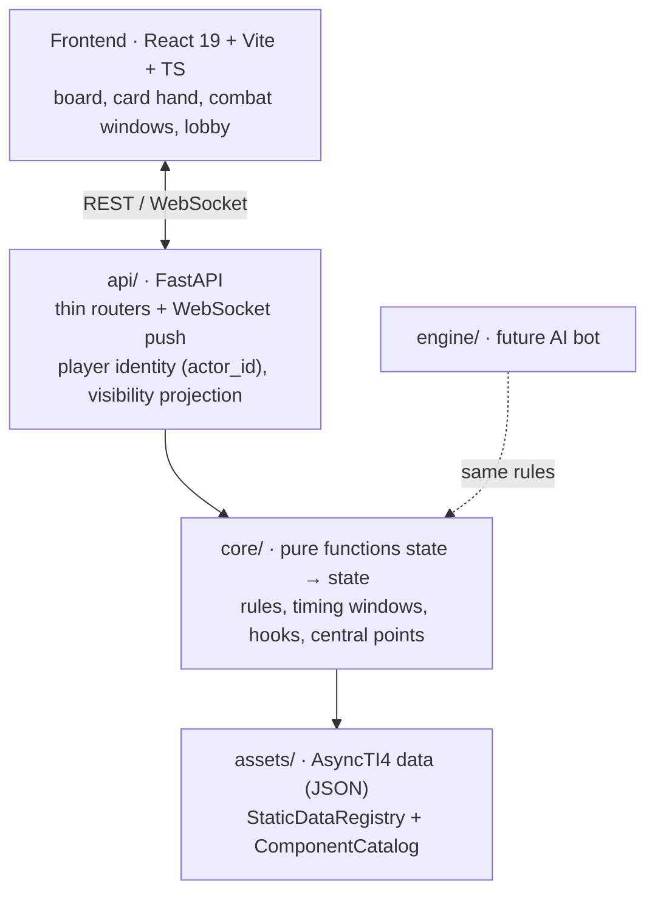

<div align="center">

# ⚜️ Custodian Engine

**Twilight Imperium 4 gameplay engine — rules referee, networked multiplayer, and (ultimately) AI bot opponent**

*Project Pax Magnifica*


[Download](#-download-and-play) · [Features](#-whats-working) · [Status](#-status) · [Architecture](#-architecture) · [Running](#-running) · [Multiplayer](#-multiplayer) · [Documentation](#-documentation)

</div>

---

Custodian Engine is a local application for playing full matches of **Twilight Imperium: 4th Edition**
(with Prophecy of Kings, Codexes I–IV, and Thunder's Edge). The engine **enforces the rules** — illegal moves are
rejected, and round flow is driven by **timing windows** where each player in turn order can react.
Playable over the network (up to 6 players, humans + bots); solo against bots is a special case.

End goal: an **autonomous bot** that pilots a faction on its own — picks strategy cards, moves fleets, fights,
votes in the agenda phase, and scores objectives. The rules engine serves as its "laws of physics".

## 📥 Download and Play

No need to install Python or Node.js:

1. Download `PaxMagnifica-<date>.zip` from the [**Releases**](https://github.com/karolm43/Pax-Magnifica/releases/latest) tab (~1.4 GB).
2. Extract the entire folder and run `PaxMagnifica.exe` (Windows). The game opens in your browser.
3. SmartScreen may warn because the binary is unsigned: "More info" → "Run anyway".

Details (multiplayer, saves) are in `JAK_GRAC.txt` inside the package. Build the release yourself: `uv run python packaging/build_release.py`.

## ✨ What's Working

| Area | Scope |
|---|---|
| 🗺️ **Board** | Hex map from AsyncTI4 map string, wormholes, anomalies, The Fracture. God-Mode with Undo/Redo. |
| 🔁 **Full round** | Strategy → Action → Status → Agenda phases; strict initiative order, passing, round limit, and victory screen with epilogue. |
| 🃏 **Strategy cards** | All 8 cards (primary + secondary), with map picks and a secondary window for all players. |
| ⚔️ **Tactical action** | Activation, movement (range, nebulae, Ion Storm), Space Cannon, space & ground combat, AFB, Sustain Damage, retreat, bombardment, invasion, production. |
| 🎲 **Dice** | Every roll is a physical d10 on a 3D stage; results computed by the engine from seedable RNG. |
| 🎴 **Action cards** | **143/143** with effects — played by dragging from hand, reaction cards in timing windows, Sabotage (hold-play), and HOLD (rewind to history step). |
| 💎 **Relics** | 23/23 active with effects (actions, passives, combat). |
| 🔬 **Technologies** | All 33 general technologies as hooks; "this technology applies here" indicators in UI. |
| 🎯 **Objectives** | 80/80 objectives checked automatically (public and secret, including event-scored ones). |
| 🏛️ **Agenda** | Galactic Council: reveal, voting, tie-breaking, laws in play. |
| 🌌 **Exploration & more** | Exploration and frontier cards, relic fragments, transactions and debt tokens, Thunder's Edge expeditions, Custodians token. |
| 🌐 **Multiplayer** | Lobby with visual wizard, seat tokens, per-player hidden hand views, file-based game saves, chess clock. |

## 📊 Status

| Stage | Scope | State |
|---|---|---|
| 1 | Digital board + God-Mode | ✅ done |
| 2 | Rule-enforcing gameplay engine | 🔧 in progress — details below; 15 factions with hooks (Arborec, Argent, Hacan, Jol-Nar, L1Z1X, Letnev, Mentak, Muaat, Naaz-Rokha, Saar, Sardakk, Sol, Winnu, Xxcha, Yin) |
| 3 | AI Bot (strategic → operational → tactical) | 🔧 early steps: bot executes tactical actions, researches technologies, bot game fuzzer exists |

Component hook coverage (from generated report [`docs/POKRYCIE_HOOKOW.md`](docs/POKRYCIE_HOOKOW.md)):

| Components | With effect | |
|---|---:|---|
| Action cards | 143 / 143 | ✅ |
| Relics | 23 / 24 | ✅ |
| Agendas | 50 / 63 | ✅ entire official deck (50/50); ⬜ fan variants (Absol) |
| Technologies | 66 / 102 | 🔧 all general; faction techs in progress |
| Promissory notes | 20 / 40 | 🔧 |
| Leaders | 45 / 102 | 🔧 |
| Faction abilities | 30 / 73 | 🔧 |
| Breakthroughs | 15 / 31 | 🔧 |
| Exploration | 4 / 80 | ⬜ |

**Next steps:** remaining factions (abilities, leaders, promissory notes, breakthroughs) → remaining timing windows → exploration → bot expansion.
Current work log: [`docs/PROGRESS.md`](docs/PROGRESS.md).

## 🏗️ Architecture



Principles keeping the project coherent:

- **Engine = referee.** Normal actions validate legality (`ValueError` → HTTP 422). God-Mode intentionally bypasses validation as a correction valve.
- **Zero rules from memory.** Stats and card texts come only from assets; every mechanic gets an entry with a source in [`docs/rules/`](docs/RULES.md) before entering code.
- **Asymmetry = hooks.** Factions, technologies, and cards modify rules via the hook registry, not `if faction == ...`.
- **Central points.** Payment, trade goods, tokens, planet control, units, VP — each has one function in `core/`, guarded by a test.
- **Downward dependencies only:** `api/` → `core/` → data. Future `engine/` calls the exact same functions as the UI.

More: [`docs/ARCHITEKTURA_KODU.md`](docs/ARCHITEKTURA_KODU.md).

## 🚀 Running

### Requirements

| Tool | Purpose |
|---|---|
| [Python ≥ 3.12](https://www.python.org/downloads/) + [uv](https://docs.astral.sh/uv/getting-started/installation/) | backend |
| [Node.js ≥ 20](https://nodejs.org/) | frontend |
### Exe
uv run python packaging/build_release.py
### Installation

```bash
git clone https://github.com/karolm43/Pax-Magnifica.git "Pax Magnifica"
cd "Pax Magnifica"
uv sync --extra dev
cd frontend && npm install && cd ..
```

Game data (JSON) is in the repo, so a fresh clone is playable immediately. **Graphics and fonts are outside the repo** — without them,
placeholders appear instead of images (the prebuilt Releases zip includes them). If you have a local copy of AsyncTI4 graphics,
copy missing files per the manifest:

```bash
uv run python -m src.audit sync_assets --from <graphics-dir>
```

### Start

**Windows:** double-click `start.cmd` (or `./start.ps1`) — starts backend (:8000), frontend (:5173), and opens the browser.

**Manual, two terminals:**

```bash
uv run python -m src.api          # backend  → http://127.0.0.1:8000
cd frontend && npm run dev        # frontend → http://localhost:5173
```

Matches auto-save in `saves/` and resume after server restart. `--save FILE` picks another file, `--fresh` starts from scratch.

<details>
<summary><b>Troubleshooting</b></summary>

- **Blank page / "Update Needed"** — backend isn't running or didn't return `web-data`; check its terminal.
- **Registry loads 0 units** — missing `assets/data/`; check: `uv run python -m src.core.registry`.
- **Missing images** — graphics are outside the repo, see `sync_assets` above (or use the Releases package).
- **Data consistency** — `uv run python -m src.audit` (entry counts, references, missing files).

</details>

## 🌐 Multiplayer

1. Host launches the game normally (`start.cmd`) and chooses **Play** in the menu → opens the lobby.
2. Other players (LAN or ZeroTier) join via the lobby invite link and pick their faction live in the wizard.
3. Each player sees only their own cards; actions for another player are rejected by backend (403), and a bar shows who we are waiting for.

Manual: `uv run python -m src.api --network` + `npm run dev -- --host`. Identity and visibility model: [`docs/rules/R44.md`](docs/rules/R44.md).

## 🧪 Quality

```bash
uv run pytest -q -n auto          # ~2000 tests, parallel
uv run ruff check src tests
uv run mypy src tests             # --strict

cd frontend
npx tsc --noEmit -p tsconfig.app.json
npm run lint && npm run build && npx vitest --run
npm run e2e                        # Playwright: solo game + networked host + guest
```

E2E spins up its own backend (:8100) and frontend (:5273), leaving any running match untouched.

## 📚 Documentation

| Document | Purpose |
|---|---|
| [`docs/README.md`](docs/README.md) | Documentation index and code map — start here |
| [`docs/PROGRESS.md`](docs/PROGRESS.md) | Work status and recent blocks |
| [`docs/PLAN_PELNA_ROZGRYWKA.md`](docs/PLAN_PELNA_ROZGRYWKA.md) | Engine plan, factions, and their gimmicks |
| [`docs/RULES.md`](docs/RULES.md) | Index of mechanical rules with sources (`docs/rules/R<NN>.md`) |
| [`docs/rules_tirules/`](docs/rules_tirules/INDEX.md) | Offline rules dump (LRR 2.0, Codexes, Thunder's Edge) |
| [`docs/ARCHITEKTURA_KODU.md`](docs/ARCHITEKTURA_KODU.md) | Layers, hooks, "card from A to Z" recipe |

## Tech Stack

**Backend:** Python 3.12, FastAPI + Uvicorn, Pydantic v2, NumPy, NetworkX, SQLite (game saves & Undo history) ·
**Frontend:** React 19, TypeScript, Vite, Zustand, react-query, custom design system ·
**QA:** pytest (+ hypothesis, xdist, testmon), ruff, mypy --strict, Vitest, Playwright.

## Credits & License

Game data comes from the community project **[AsyncTI4](https://github.com/AsyncTI4/TI4_map_generator_bot)**,
and the board frontend grew out of its `ti4_web` viewer. Rules: [tirules2.com](https://tirules2.com) and Living Rules Reference.

Code license: TBD. *Twilight Imperium* is a trademark of Fantasy Flight Games; this is an unofficial fan
project. AsyncTI4 data and graphics are subject to that project's terms.

## ⚖️ Legal Notice

- **Unofficial, fan-made, non-commercial project.** Not affiliated with Fantasy Flight Games, Asmodee, or
  any publisher. *Twilight Imperium*, its names, factions, cards, texts, and artwork are property of their owners
  (Fantasy Flight Games / Asmodee) and used solely for fan purposes. This project does not replace the physical board game.
- **AsyncTI4.** Game data (JSON/properties) as well as graphics, fonts, and music in the package come from
  [AsyncTI4](https://github.com/AsyncTI4/TI4_map_generator_bot) and its community. AsyncTI4 code is under the
  Unlicense (public domain), but **that license does not cover art assets** ("NOT art assets") — they
  remain the property of their respective authors. We claim no rights to them.
- **Custodian Engine code** (`src/`, `frontend/`, `tests/`): license not yet chosen — until added,
  default author copyright applies.
- **No warranty.** Software is provided "as is", without warranty of any kind; the author is not liable for
  any damages arising from its use.
- **Takedown on request.** If you own the rights to any item and want it removed from the repository
  or package, open an issue in the Issues tab — it will be removed promptly.
