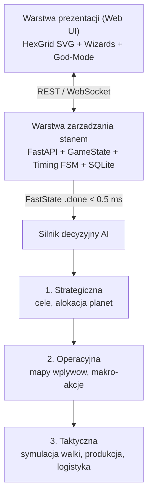

# Custodian Engine

> Lokalny silnik sztucznej inteligencji pełniący rolę autonomicznego przeciwnika przy stole do fizycznych rozgrywek **Twilight Imperium: 4th Edition** — z myślą o grze solo.

Custodian Engine zastępuje gracza ludzkiego pełnoprawnym agentem podejmującym decyzje strategiczne, operacyjne, taktyczne i dyplomatyczne. Fizyczna plansza pozostaje nadrzędnym źródłem prawdy (model *human-in-the-loop*), a silnik wylicza i komunikuje ruchy bota.

## Status projektu

🚧 **Faza 1 (fundament danych + mapa + God-Mode) — niemal ukończona.** Działa rdzeń
stanu (rejestr danych, `HexGrid`, `GameState`, Event Sourcing/Undo), API FastAPI oraz
frontend-viewer renderujący planszę i panele graczy. Największa otwarta luka: brak UI
do edycji stanu (na razie przez API). Pełny, aktualny opis architektury i stanu prac:
**[docs/ARCHITEKTURA_PO_MIGRACJI.md](docs/ARCHITEKTURA_PO_MIGRACJI.md)** oraz historia
w [docs/PROGRESS.md](docs/PROGRESS.md).

> Frontend: po migracji używamy viewera planszy opartego na AsyncTI4 `ti4_web`
> (React 19 + Vite + TS, własny design system) zamiast własnego SVG. Backend tłumaczy
> `GameState` na dokument `web-data`, z którego front renderuje całą planszę.

## Stos technologiczny

| Warstwa | Technologie |
| --- | --- |
| Język / środowisko | Python 3.12+, `uv`, `mypy --strict` |
| Dane / walidacja | Pydantic v2 |
| Obliczenia / symulacje | NumPy + Numba (`@njit`) |
| Graf mapy | rustworkx / NetworkX |
| Solvery | Branch & Bound (NumPy), opcjonalnie OR-Tools (CP-SAT) |
| API | FastAPI + Uvicorn (REST + WebSocket) |
| Trwałość | SQLite 3 (Snapshot Stack / Memento) |
| Frontend | React 19 + TypeScript + Vite, Zustand, react-query (viewer `ti4_web`, własny design system) |
| QA | pytest + pytest-cov + hypothesis, Ruff |

## Architektura

System jest warstwowy, z wyraźnym rozdziałem między walidowanym stanem gry (`GameState`, Pydantic) a numerycznym stanem symulacyjnym (`FastState`, NumPy).



Szczegóły: [docs/specyfikacja_techniczna_i_architektura_systemu.md](docs/specyfikacja_techniczna_i_architektura_systemu.md)

## Roadmapa

- [ ] **M1 — Rdzeń stanu, topologia i assety:** `StaticDataRegistry`, modele Pydantic, `HexGrid` (współrzędne kubiczne, tunele, anomalie), `GameState` → `FastState`, `EventStore` (Undo/Redo/God-Mode).
- [ ] **M2 — Warstwa taktyczna + podstawowy UI:** wektoryzowany symulator walk (NumPy/Numba), solver produkcji, logistyka floty, endpointy FastAPI, mapa SVG.
- [ ] **M3 — Warstwa strategiczna:** ewaluator celów, solver alokacji planet, wybór kart strategii.
- [ ] **M4 — Warstwa operacyjna:** mapy wpływów i zagrożeń, generator makro-akcji, planista kolejności (1-step lookahead + urgency).
- [ ] **M5 — Dyplomacja i kontrola lidera:** ocena zagrożeń, wycena ofert handlowych, głosowanie w fazie agendy.
- [ ] **M6 — Asymetria frakcyjna + integracja głosowa:** reguły frakcyjne w `rules_hooks`, parser komend głosowych (voice-to-state).

### Plany: warianty fanowskie

- **Black Spectrum Firmament Plots** — fanowska zmiana, która ma ZASTĘPOWAĆ standardowe
  Firmament Plots. W Ustawieniach (Game variants) jest już przełącznik
  (`settings.blackSpectrumFirmamentPlots`), ale **efekt nie jest jeszcze zakodowany** —
  do zrobienia później. Dane kart: `assets/data/genericcards/black_spectrum_firmament_plots.json`.
  Wzorzec wdrożenia: jak talia agend Absol (ustawienie klienta → pole w `/game/new` →
  wybór talii w `DecksState`).

## Struktura repozytorium

```
custodian-engine/
├── README.md
├── .gitignore
├── docs/
│   └── specyfikacja_techniczna_i_architektura_systemu.md
├── src/
│   ├── core/            # stan, rejestr danych, topologia, event store
│   └── engine/
│       ├── strategic/   # cele, alokacja makroekonomiczna
│       ├── operational/ # mapy wplywow, makro-akcje, planista
│       ├── tactical/    # walka, produkcja, logistyka
│       └── diplomacy/   # ocena zagrozen, handel, agenda
├── tests/
└── assets/              # lokalne (poza repo) - patrz nizej
```

## Dane i assety

Dane gry (statystyki jednostek, planety, kafelki, technologie, cele) pochodzą z projektu społecznościowego **[AsyncTI4](https://github.com/AsyncTI4/TI4_map_generator_bot)** i leżą lokalnie w katalogu `assets/`. Zgodnie ze specyfikacją (sekcja 5.1):

- **Zakaz hardkodowania** — żadne statystyki ani parametry nie są zaszyte w kodzie; wszystko ładowane z zewnętrznych plików JSON, a ścieżki zdefiniowane w `src/config.py`.
- **Źródło prawdy o źródłach** — plik `assets/data/sources/sources.json` opisuje każde źródło danych polem `canal` (`official` / `community`), co pozwala deterministycznie filtrować zawartość oficjalną od fanowskiej (homebrew).
- **Zakres na start** — silnik używa wyłącznie **oficjalnych** źródeł: `base`, `pok`, `codex1`–`codex4`, `keleres`. Dodatki fanowskie (Discordant Stars, Milty Mod, Sigma, Absol itd.) pozostają w assetach, ale nie są ładowane.
- **Grafiki poza repo** — obrazy i fonty (setki MB) są wykluczone z repozytorium przez `.gitignore`. Repo wersjonuje docelowo tylko dane JSON potrzebne silnikowi.

## Instalacja i uruchomienie (od zera, na nowym komputerze)

Aplikacja ma dwie części: **backend** (Python/FastAPI, port 8000) i **frontend**
(React/Vite, port 5173). Poniżej pełna procedura — jeśli coś nie działało na innym
komputerze, to niemal na pewno brak **assetów** albo **zależności** (patrz niżej).

### Wymagania wstępne

Zainstaluj (jednorazowo):

| Narzędzie | Do czego | Instalacja |
| --- | --- | --- |
| **Python ≥ 3.12** | backend | [python.org](https://www.python.org/downloads/) |
| **uv** | menedżer zależności Pythona | [docs.astral.sh/uv](https://docs.astral.sh/uv/getting-started/installation/) (np. `pip install uv`) |
| **Node.js ≥ 20** | frontend (Vite) | [nodejs.org](https://nodejs.org/) (zawiera `npm`) |
| **Git** | klonowanie repo | [git-scm.com](https://git-scm.com/) |

### Krok 1 — sklonuj repozytorium

```bash
git clone <adres-repo> "Pax Magnifica"
cd "Pax Magnifica"
```

### Krok 2 — assety (NAJCZĘSTSZA przyczyna „nie działa") ⚠️

Backend czyta dane gry (statystyki jednostek, planety, kafelki, karty strategii, alias
pozycji) z katalogu **`assets/`** w korzeniu repo. Te ścieżki są zdefiniowane w
`src/config.py` i **nie można ich hardkodować gdzie indziej**.

> **Dlaczego to częsty błąd:** domyślnie `.gitignore` wyklucza `assets/*` z repozytorium,
> więc świeży `git clone` NIE zawiera danych i backend się nie uruchomi (albo rejestr
> załaduje 0 jednostek). Grafiki/fonty i tak nie są w repo — frontend bierze je z CDN
> AsyncTI4 (`images.asyncti4.com`).

Masz dwie drogi. **Zalecana: wersjonowanie danych JSON** (patrz sekcja „Wersjonowanie
danych w repo" niżej) — wtedy `git clone` wystarcza i ten krok odpada. Jeśli trzymasz
assety poza repo, skopiuj je ręcznie tak, aby powstała dokładnie taka struktura:

```
Pax Magnifica/
└── assets/
    ├── enabled_sources.json        # jest w repo (konfiguracja aktywnych źródeł)
    ├── data/                        # units, planets, factions, technologies,
    │                                # strategy_cards, strategy_card_sets, sources
    ├── systems/                     # definicje systemów (kafelków)
    ├── planets/                     # definicje planet
    └── alias/                       # position_alias.properties (pozycje mapy)
```

Źródło danych: projekt [AsyncTI4](https://github.com/AsyncTI4/TI4_map_generator_bot)
(katalog `src/main/resources/data` oraz `.../resources/positions`). Kopiujemy TYLKO
pliki JSON/properties potrzebne silnikowi — grafik i fontów NIE trzeba (lecą z CDN).

**Jak sprawdzić, że assety są na miejscu** (powinno pokazać setki jednostek/planet, nie zera):

```bash
uv run python -m src.core.registry
```

### Krok 3 — zależności backendu

```bash
uv sync --extra dev
```

(`uv` utworzy `.venv/` i zainstaluje wszystko z `pyproject.toml`.)

### Krok 4 — zależności frontendu

```bash
cd frontend
npm install
cd ..
```

### Krok 5 — uruchom

**Windows (najprościej):** dwuklik w `start.cmd` albo w katalogu repo:

```powershell
./start.ps1
```

Skrypt zwalnia port 8000, startuje backend i frontend w osobnych oknach i otwiera
przeglądarkę na `http://localhost:5173/`.

**Ręcznie (dowolny system), dwa terminale:**

```bash
# terminal 1 — backend
uv run python -m src.api

# terminal 2 — frontend
cd frontend
npm run dev
```

Potem otwórz `http://localhost:5173/`. Frontend woła backend przez proxy Vite
(`/bot/...` → `http://127.0.0.1:8000`), więc oba muszą działać równocześnie.

### Wersjonowanie danych w repo (zalecane — klon „działa od ręki")

Aby `git clone` wystarczał do uruchomienia (bez ręcznego kopiowania assetów), włącz
wersjonowanie samych **danych JSON** (grafiki/fonty zostają poza repo). W `.gitignore`
zamień blok `assets/*` na wyjątki dla katalogów danych:

```gitignore
# Dane gry wchodzą do repo; grafiki/fonty zostają ignorowane.
assets/*
!assets/enabled_sources.json
!assets/data/
!assets/systems/
!assets/planets/
!assets/alias/
# Grafiki i fonty NIE wchodzą (setki MB) — frontend bierze je z CDN AsyncTI4:
assets/**/*.png
assets/**/*.webp
assets/**/*.jpg
assets/**/*.jpeg
assets/**/*.gif
assets/**/*.ttf
assets/**/*.otf
assets/**/*.woff
assets/**/*.woff2
```

Następnie `git add assets/` i commit — od tej pory każdy klon ma komplet danych.
Dane JSON to kilka–kilkanaście MB, nie setki.

### Typowe problemy

- **Biała strona / „Update Needed":** backend nie działa albo nie oddał `web-data`.
  Sprawdź okno backendu i czy `uv run python -m src.core.registry` pokazuje dane.
- **Rejestr ładuje 0 jednostek:** brak `assets/data/...` (patrz Krok 2).
- **Frontend nie łączy się z backendem:** backend musi stać na `:8000` zanim otworzysz stronę.
- **`uv`/`npm` nieznane:** nie zainstalowane lub nie w PATH (patrz Wymagania wstępne).

## Licencja

Do ustalenia. Dane i grafiki z AsyncTI4 podlegają warunkom tamtego projektu i licencji Fantasy Flight Games / Twilight Imperium.
