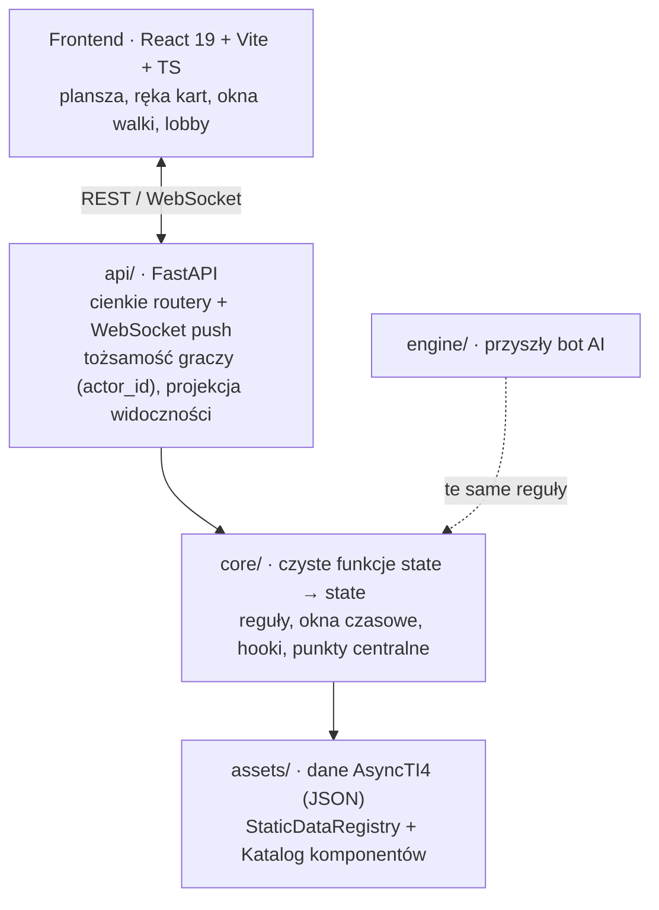

<div align="center">

# ⚜️ Custodian Engine

**Silnik rozgrywki Twilight Imperium 4 — sędzia reguł, gra sieciowa i (docelowo) bot-przeciwnik**

*Projekt Pax Magnifica*


[Pobierz](#-pobierz-i-graj) · [Funkcje](#-co-już-działa) · [Status](#-status) · [Architektura](#-architektura) · [Uruchomienie](#-uruchomienie) · [Gra sieciowa](#-gra-sieciowa) · [Dokumentacja](#-dokumentacja)

</div>

---

Custodian Engine to lokalna aplikacja do rozgrywania pełnych partii **Twilight Imperium: 4th Edition**
(z Prophecy of Kings, Codexami I–IV i Thunder's Edge). Silnik **pilnuje reguł** — nielegalny ruch zostaje
odrzucony, a przebieg rundy prowadzą **okna czasowe**, w których każdy gracz po kolei może zareagować.
Grać można przez sieć (do 6 graczy, ludzie + boty); gra solo z botami to szczególny przypadek.

Cel końcowy: **autonomiczny bot**, który sam prowadzi frakcję — wybiera strategie, rusza flotami, walczy,
głosuje na agendzie i punktuje cele. Silnik reguł jest jego „prawami fizyki”.

## 📥 Pobierz i graj

Nie musisz instalować Pythona ani Node.js:

1. Pobierz `PaxMagnifica-<data>.zip` z zakładki [**Releases**](https://github.com/karolm43/Pax-Magnifica/releases/latest) (~1,4 GB).
2. Rozpakuj cały folder i uruchom `PaxMagnifica.exe` (Windows). Gra otworzy się w przeglądarce.
3. SmartScreen może ostrzec, bo plik nie jest podpisany: „Więcej informacji” → „Uruchom mimo to”.

Szczegóły (gra sieciowa, zapisy) są w `JAK_GRAC.txt` w paczce. Budowanie paczki samemu: `uv run python packaging/build_release.py`.

## ✨ Co już działa

| Obszar | Zakres |
|---|---|
| 🗺️ **Plansza** | Mapa heksowa z map stringa AsyncTI4, tunele czasoprzestrzenne, anomalie, The Fracture. God-Mode z Undo/Redo. |
| 🔁 **Pełna runda** | Faza strategii → akcji → statusu → agendy; ścisła kolejność inicjatywy, pas, limit rund i ekran zwycięstwa z epilogiem. |
| 🃏 **Karty strategii** | Wszystkie 8 kart (primary + secondary), z wyborami na mapie i oknem secondary dla wszystkich graczy. |
| ⚔️ **Akcja taktyczna** | Aktywacja, ruch (zasięg, mgławice, Ion Storm), Space Cannon, walka kosmiczna i naziemna, AFB, Sustain Damage, odwrót, bombardowanie, inwazja, produkcja. |
| 🎲 **Kości** | Każdy rzut to fizyczny d10 na scenie 3D; wynik liczy silnik z seedowalnego RNG. |
| 🎴 **Karty akcji** | **143/143** z efektem — zagrywane przeciąganiem z ręki, karty reakcji w oknach czasowych, Sabotage (hold-play) i HOLD (cofnięcie do kroku historii). |
| 💎 **Relikty** | 23/23 aktywnych z efektem (akcje, pasywy, walka). |
| 🔬 **Technologie** | Wszystkie 33 technologie ogólne jako hooki; wskaźniki „ta technologia działa tutaj” w UI. |
| 🎯 **Cele** | 80/80 celów sprawdzanych automatycznie (publiczne i tajne, także te zdobywane zdarzeniami). |
| 🏛️ **Agenda** | Rada Galaktyczna: ujawnienie, głosowanie, remis, prawa w grze. |
| 🌌 **Eksploracja i więcej** | Karty eksploracji i frontier, fragmenty reliktów, transakcje i żetony długu, ekspedycje Thunder's Edge, żeton Custodians. |
| 🌐 **Gra sieciowa** | Lobby z graficznym kreatorem, tokeny miejsc, widok każdego gracza tylko jego kart, zapis partii w pliku, zegar szachowy. |

## 📊 Status

| Etap | Zakres | Stan |
|---|---|---|
| 1 | Cyfrowa plansza + God-Mode | ✅ gotowe |
| 2 | Silnik rozgrywki egzekwujący reguły | 🔧 w toku — szczegóły niżej |
| 3 | Bot AI (strategiczny → operacyjny → taktyczny) | ⬜ po silniku |

Pokrycie komponentów hookami (z generowanego raportu [`docs/POKRYCIE_HOOKOW.md`](docs/POKRYCIE_HOOKOW.md)):

| Komponenty | Z efektem | |
|---|---:|---|
| Karty akcji | 143 / 143 | ✅ |
| Relikty | 23 / 24 | ✅ |
| Agendy | 50 / 63 | 🔧 głosowanie działa, część efektów w kolejce |
| Technologie | 62 / 102 | 🔧 wszystkie ogólne; frakcyjne w toku |
| Promissory notes | 18 / 40 | 🔧 |
| Liderzy | 39 / 102 | 🔧 |
| Zdolności frakcji | 26 / 73 | 🔧 |
| Przełomy | 13 / 31 | 🔧 |
| Eksploracja | 4 / 80 | ⬜ |

**Następne kroki:** reszta agend → zdolności frakcji, liderzy i promissory notes → reszta okien czasowych → bot.
Bieżący dziennik prac: [`docs/PROGRESS.md`](docs/PROGRESS.md).

## 🏗️ Architektura



Zasady, które trzymają projekt w ryzach:

- **Silnik = sędzia.** Zwykła akcja waliduje legalność (`ValueError` → HTTP 422). God-Mode celowo omija walidację jako wentyl korekty.
- **Zero reguł z pamięci.** Statystyki i teksty kart tylko z assetów; każda mechanika ma wpis ze źródłem w [`docs/rules/`](docs/RULES.md) zanim trafi do kodu.
- **Asymetria = hooki.** Frakcje, technologie i karty modyfikują reguły przez rejestr hooków, nie przez `if faction == ...`.
- **Punkty centralne.** Płatność, trade goods, żetony, kontrola planet, jednostki, VP — każde ma jedną funkcję w `core/`, pilnowaną testem.
- **Zależności tylko w dół:** `api/` → `core/` → dane. Przyszłe `engine/` woła te same funkcje co UI.

Więcej: [`docs/ARCHITEKTURA_KODU.md`](docs/ARCHITEKTURA_KODU.md).

## 🚀 Uruchomienie

### Wymagania

| Narzędzie | Do czego |
|---|---|
| [Python ≥ 3.12](https://www.python.org/downloads/) + [uv](https://docs.astral.sh/uv/getting-started/installation/) | backend |
| [Node.js ≥ 20](https://nodejs.org/) | frontend |

### Instalacja

```bash
git clone https://github.com/karolm43/Pax-Magnifica.git "Pax Magnifica"
cd "Pax Magnifica"
uv sync --extra dev
cd frontend && npm install && cd ..
```

Dane gry i `assets/` są w repo, więc klon jest od razu grywalny. Gdyby brakowało grafik albo fontów (zaślepki
zamiast obrazków), skopiuj brakujące pliki z lokalnej kopii AsyncTI4 według manifestu:

```bash
uv run python -m src.audit sync_assets --from <katalog-z-grafikami>
```

### Start

**Windows:** dwuklik w `start.cmd` (albo `./start.ps1`) — wstaje backend (:8000), frontend (:5173) i otwiera się przeglądarka.

**Ręcznie, dwa terminale:**

```bash
uv run python -m src.api          # backend  → http://127.0.0.1:8000
cd frontend && npm run dev        # frontend → http://localhost:5173
```

Partia zapisuje się w `saves/` i wznawia po restarcie serwera. `--save PLIK` wybiera inny plik, `--fresh` zaczyna od zera.

<details>
<summary><b>Typowe problemy</b></summary>

- **Biała strona / „Update Needed”** — backend nie działa albo nie oddał `web-data`; sprawdź jego okno.
- **Rejestr ładuje 0 jednostek** — brak `assets/data/`; sprawdź: `uv run python -m src.core.registry`.
- **Brak obrazków** — brakujące assety uzupełnij przez `sync_assets` (wyżej).
- **Spójność danych** — `uv run python -m src.audit` (liczby wpisów, referencje, brakujące pliki).

</details>

## 🌐 Gra sieciowa

1. Host uruchamia grę normalnie (`start.cmd`) i wybiera w menu **Play** → otwiera się lobby.
2. Pozostali gracze (LAN albo ZeroTier) wchodzą z linku z lobby i wybierają frakcję w kreatorze na żywo.
3. Każdy widzi tylko swoje karty; akcje cudzego gracza backend odrzuca (403), a pasek pokazuje, na kogo czekamy.

Ręcznie: `uv run python -m src.api --network` + `npm run dev -- --host`. Model tożsamości i widoczności: [`docs/rules/R44.md`](docs/rules/R44.md).

## 🧪 Jakość

```bash
uv run pytest -q -n auto          # ~2000 testów, równolegle
uv run ruff check src tests
uv run mypy src tests             # --strict

cd frontend
npx tsc --noEmit -p tsconfig.app.json
npm run lint && npm run build && npx vitest --run
npm run e2e                        # Playwright: gra solo + gra sieciowa host + gość
```

E2E stawia własny backend (:8100) i front (:5273), więc nie dotyka trwającej partii.

## 📚 Dokumentacja

| Dokument | Po co |
|---|---|
| [`docs/README.md`](docs/README.md) | Indeks dokumentacji i mapa kodu — zacznij tutaj |
| [`docs/PROGRESS.md`](docs/PROGRESS.md) | Stan prac i ostatnie bloki |
| [`docs/PLAN_PELNA_ROZGRYWKA.md`](docs/PLAN_PELNA_ROZGRYWKA.md) | Plan silnika, frakcje i ich gimmicki |
| [`docs/RULES.md`](docs/RULES.md) | Indeks reguł mechanicznych ze źródłami (`docs/rules/R<NN>.md`) |
| [`docs/rules_tirules/`](docs/rules_tirules/INDEX.md) | Offline zrzut reguł (LRR 2.0, Codexy, Thunder's Edge) |
| [`docs/ARCHITEKTURA_KODU.md`](docs/ARCHITEKTURA_KODU.md) | Warstwy, hooki, przepis „karta od A do Z” |

## Stos technologiczny

**Backend:** Python 3.12, FastAPI + Uvicorn, Pydantic v2, NumPy, NetworkX, SQLite (zapis partii i historia Undo) ·
**Frontend:** React 19, TypeScript, Vite, Zustand, react-query, własny design system ·
**QA:** pytest (+ hypothesis, xdist, testmon), ruff, mypy --strict, Vitest, Playwright.

## Podziękowania i licencja

Dane gry pochodzą z projektu społecznościowego **[AsyncTI4](https://github.com/AsyncTI4/TI4_map_generator_bot)**,
a frontend planszy wyrósł z jego viewera `ti4_web`. Reguły: [tirules2.com](https://tirules2.com) i Living Rules Reference.

Licencja kodu: do ustalenia. *Twilight Imperium* jest znakiem towarowym Fantasy Flight Games; to nieoficjalny projekt
fanowski. Dane i grafiki AsyncTI4 podlegają warunkom tamtego projektu.
