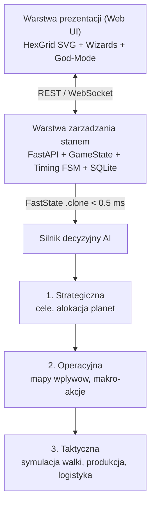

# Custodian Engine

> Lokalny silnik sztucznej inteligencji pełniący rolę autonomicznego przeciwnika przy stole do fizycznych rozgrywek **Twilight Imperium: 4th Edition** — z myślą o grze solo.

Custodian Engine zastępuje gracza ludzkiego pełnoprawnym agentem podejmującym decyzje strategiczne, operacyjne, taktyczne i dyplomatyczne. Fizyczna plansza pozostaje nadrzędnym źródłem prawdy (model *human-in-the-loop*), a silnik wylicza i komunikuje ruchy bota.

## Status projektu

🚧 **Wczesny etap — faza startowa.** Repozytorium zawiera na razie wizytówkę projektu i szkielet struktury. Implementacja startuje od Kamienia Milowego 1 (rdzeń stanu i topologia).

## Stos technologiczny

| Warstwa | Technologie |
| --- | --- |
| Język / środowisko | Python 3.12+, `uv`, `mypy --strict` |
| Dane / walidacja | Pydantic v2 |
| Obliczenia / symulacje | NumPy + Numba (`@njit`) |
| Graf mapy | rustworkx / NetworkX |
| Solvery | Branch & Bound (NumPy), opcjonalnie OR-Tools (CP-SAT) |
| API | FastAPI + Uvicorn (REST + WebSocket) |
| Trwałość | SQLite 3 (Snapshot Stack / Memento) |
| Frontend | React 19 + TypeScript + Vite, Zustand, Tailwind, shadcn/ui |
| QA | pytest + pytest-cov + hypothesis, Ruff |

## Architektura

System jest warstwowy, z wyraźnym rozdziałem między walidowanym stanem gry (`GameState`, Pydantic) a numerycznym stanem symulacyjnym (`FastState`, NumPy).



Szczegóły: [docs/specyfikacja_techniczna_i_architektura_systemu.md](docs/specyfikacja_techniczna_i_architektura_systemu.md)

## Roadmapa

- [ ] **M1 — Rdzeń stanu, topologia i assety:** `StaticDataRegistry`, modele Pydantic, `HexGrid` (współrzędne kubiczne, tunele, anomalie), `GameState` → `FastState`, `EventStore` (Undo/Redo/God-Mode).
- [ ] **M2 — Warstwa taktyczna + podstawowy UI:** wektoryzowany symulator walk (NumPy/Numba), solver produkcji, logistyka floty, endpointy FastAPI, mapa SVG.
- [ ] **M3 — Warstwa strategiczna:** ewaluator celów, solver alokacji planet, wybór kart strategii.
- [ ] **M4 — Warstwa operacyjna:** mapy wpływów i zagrożeń, generator makro-akcji, planista kolejności (1-step lookahead + urgency).
- [ ] **M5 — Dyplomacja i kontrola lidera:** ocena zagrożeń, wycena ofert handlowych, głosowanie w fazie agendy.
- [ ] **M6 — Asymetria frakcyjna + integracja głosowa:** reguły frakcyjne w `rules_hooks`, parser komend głosowych (voice-to-state).

## Struktura repozytorium

```
custodian-engine/
├── README.md
├── .gitignore
├── docs/
│   └── specyfikacja_techniczna_i_architektura_systemu.md
├── src/
│   ├── core/            # stan, rejestr danych, topologia, event store
│   └── engine/
│       ├── strategic/   # cele, alokacja makroekonomiczna
│       ├── operational/ # mapy wplywow, makro-akcje, planista
│       ├── tactical/    # walka, produkcja, logistyka
│       └── diplomacy/   # ocena zagrozen, handel, agenda
├── tests/
└── assets/              # lokalne (poza repo) - patrz nizej
```

## Dane i assety

Dane gry (statystyki jednostek, planety, kafelki, technologie, cele) pochodzą z projektu społecznościowego **[AsyncTI4](https://github.com/AsyncTI4/TI4_map_generator_bot)** i leżą lokalnie w katalogu `assets/`. Zgodnie ze specyfikacją (sekcja 5.1):

- **Zakaz hardkodowania** — żadne statystyki ani parametry nie są zaszyte w kodzie; wszystko ładowane z zewnętrznych plików JSON, a ścieżki zdefiniowane w `src/config.py`.
- **Źródło prawdy o źródłach** — plik `assets/data/sources/sources.json` opisuje każde źródło danych polem `canal` (`official` / `community`), co pozwala deterministycznie filtrować zawartość oficjalną od fanowskiej (homebrew).
- **Zakres na start** — silnik używa wyłącznie **oficjalnych** źródeł: `base`, `pok`, `codex1`–`codex4`, `keleres`. Dodatki fanowskie (Discordant Stars, Milty Mod, Sigma, Absol itd.) pozostają w assetach, ale nie są ładowane.
- **Grafiki poza repo** — obrazy i fonty (setki MB) są wykluczone z repozytorium przez `.gitignore`. Repo wersjonuje docelowo tylko dane JSON potrzebne silnikowi.

## Licencja

Do ustalenia. Dane i grafiki z AsyncTI4 podlegają warunkom tamtego projektu i licencji Fantasy Flight Games / Twilight Imperium.
